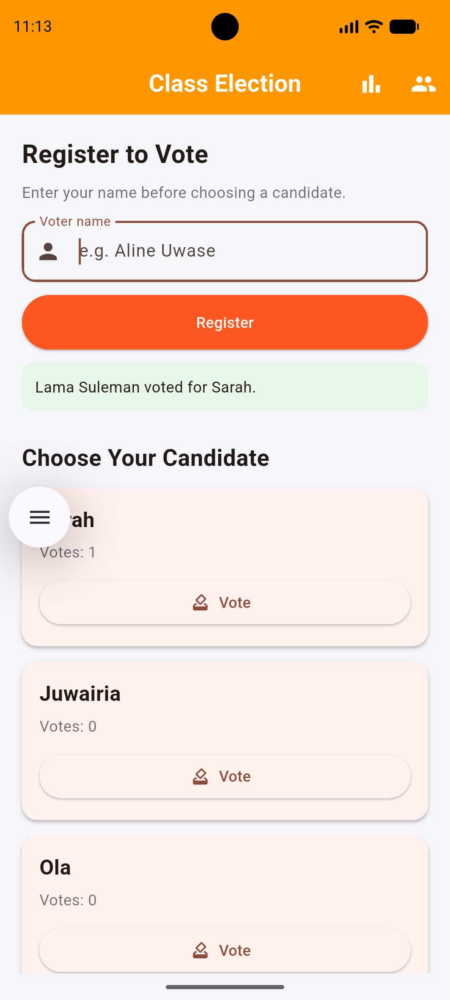
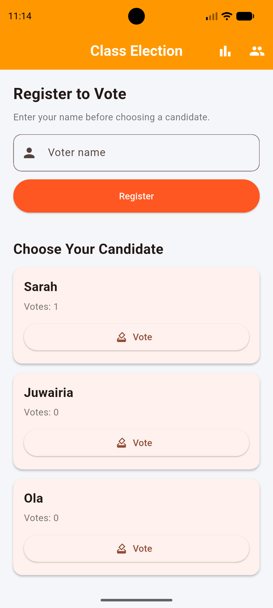
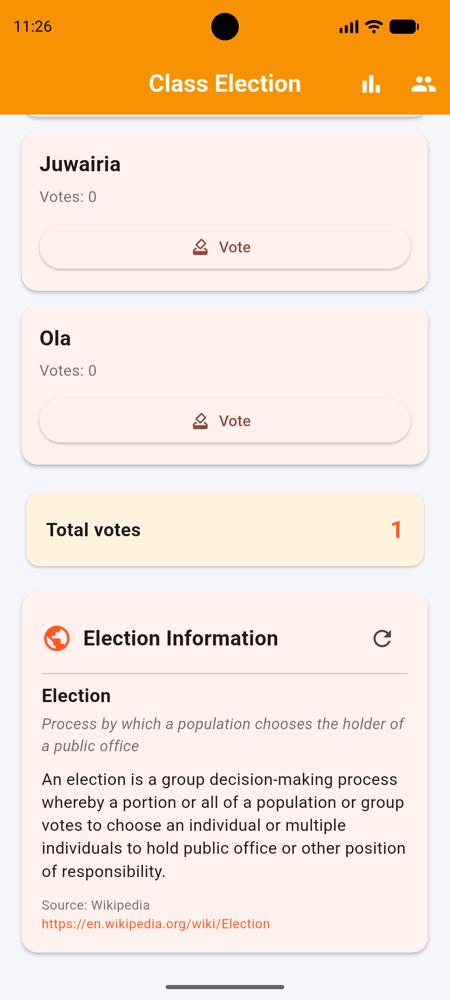
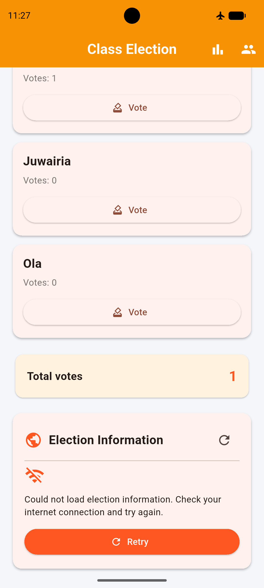

# Class Election

A Flutter app that allows users to vote for candidates and view election results. My data is now saved on the phone with `shared_preferences`, so nothing is lost when the app closes, and it shows election-related information from the Wikipedia REST API.

## Screenshots

